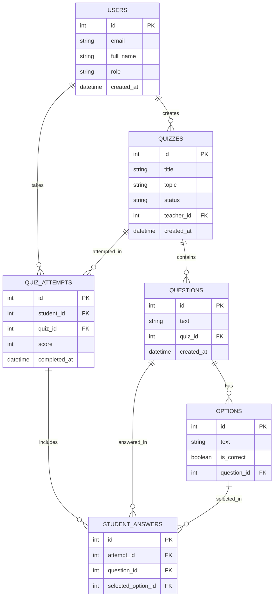

# Деректер моделі (6-сабақ)

## Кестелер (AI-сыз, өзіңіз)
- users: id, email, full_name, role, created_at
- quizzes: id, title, topic, status, teacher_id, created_at
- questions: id, text, quiz_id, created_at
- options: id, text, is_correct, question_id
- quiz_attempts: id, student_id, quiz_id, score, completed_at
- student_answers: id, attempt_id, question_id, selected_option_id

## Байланыстар
- users 1 — көп quizzes: бір мұғалім көп тест құра алады
- quizzes 1 — көп questions: бір тестте көп сұрақ болады
- questions 1 — көп options: бір сұрақта көп жауап нұсқасы болады
- users 1 — көп quiz_attempts: бір студент көп рет тест тапсыра алады
- quizzes 1 — көп quiz_attempts: бір тестті көп студент тапсыра алады
- quiz_attempts 1 — көп student_answers: бір тест тапсыру әрекетінде көп жауап болады

## ER диаграммасы

