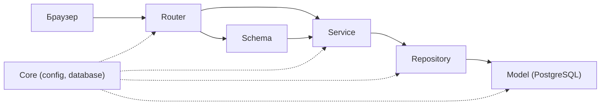

# Қабат картасы (4-сабақ)

Жоба: QuizAI — мұғалімдерге арналған жергілікті LLM (Ollama) көмегімен тест генерациялайтын жүйе.

| Қабат | 1-әрекет: Мұғалім тест жасайды | 2-әрекет: Студент тестті алады |
|---|---|---|
| Router | `POST /api/v1/quizzes/generate` • `teacher` | `GET /api/v1/quizzes/{id}` • `student` |
| Schema | `QuizGenerateRequest` -> `QuizResponse` | `None` -> `QuizStudentResponse` (`correct_index` жоқ) |
| Service | Сұрақ саны 1–50; тақырып бос емес; LLM timeout & fallback | Дұрыс жауаптарды студенттен жасыру; нәтижені есептеу; domain error |
| Repository | `QuizRepository.create` | `QuizRepository.get_by_id` |
| Model | `quizzes`, `questions`, `options` | `quiz_attempts`, `student_answers` |
| Қате-HTTP | Валидация қатесі -> 422; Рөл қате -> 403; LLM қатесі -> 502 | Квиз табылмаса -> 404; Токен жарамсыз -> 401 |

## Біздің ереже
- Router-де SQL жоқ, service-те HTTPException жоқ
- Құпиялар тек .env-те
- Студентке арналған схемада дұрыс жауап (`correct_index`) БОЛМАЙДЫ
- Модель өзгерсе — жаңа Alembic миграциясы міндетті
- Тесттерде нақты LLM шақырылмайды (`LLM_PROVIDER=fake` немесе mock)