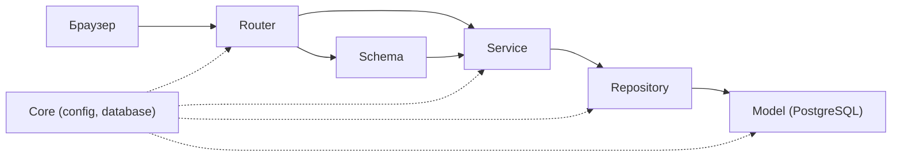

# Қабат картасы (4-сабақ)

| Қабат | <1-әрекет: кім не істейді> | <2-әрекет> |
|---|---|---|
| Router | <әдіс /api/...> • <рөл> | |
| Schema | <Кіріс> -> <Шығыс> | |
| Service | <ереже 1>; <ереже 2> | |
| Repository | <Объект>Repository.<әдіс> | |
| Model | <кесте> | |
| Қате-HTTP | <жағдай> -> <код> | |

## Біздің ереже
- Router-де SQL жоқ, service-те HTTPException жоқ
- Құпиялар тек .env-те