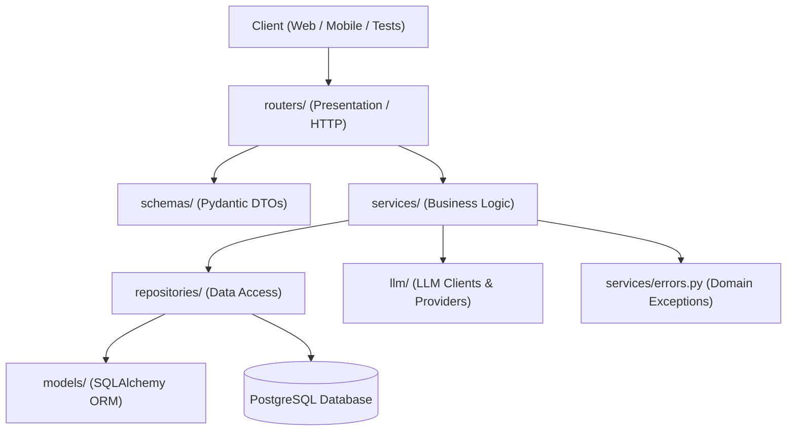

# QuizAI Architecture Layers Specification

This document defines the architectural layers of the **QuizAI** application, their responsibilities, dependency rules, and strict boundaries.

---

## 1. Overview & Dependency Graph

QuizAI follows a strict **Layered Clean Architecture**. High-level modules must not depend on low-level implementation details, and request flow must follow the defined hierarchy without skipping layers.



### Dependency Rules Summary
- `routers/` depends on `services/`, `schemas/`, and auth dependencies.
- `services/` depends on `repositories/`, `llm/`, and `services/errors.py`.
- `repositories/` depends on `models/` and SQLAlchemy sessions.
- `models/` only defines database entities and relationships.
- `llm/` only implements LLM client integrations (e.g., Ollama, Fake/Mock).

---

## 2. Layer Specifications

### 2.1. Presentation Layer (`routers/`)
- **Primary Responsibility:** Handle HTTP requests and responses, route definitions, parameter parsing, and role-based access control.
- **Rules & Constraints:**
  - ❌ **No SQL or database operations:** Direct queries (`session.execute`, `select(...)`) are strictly prohibited.
  - ❌ **No business logic:** Calculation, validation of domain rules, and scoring logic belong to `services/`.
  - ✅ **Role verification:** User roles must be authenticated and authorized using FastAPI dependencies:
    ```python
    @router.post("/generate", dependencies=[Depends(require_role("teacher"))])
    async def generate_quiz(...):
        ...
    ```
  - ✅ **Exception handling:** Catches domain exceptions from `services/errors.py` and translates them into standard `HTTPException` responses (e.g., 400, 403, 404, 422).

---

### 2.2. DTO & Validation Layer (`schemas/`)
- **Primary Responsibility:** Serialization, deserialization, and request/response schema validation using **Pydantic v2**.
- **Rules & Constraints:**
  - ❌ **Student privacy protection:** Any schema delivered to students **MUST NOT** include answers or `correct_index` fields.
  - ❌ **No secrets or mass-assignment:** Do not accept role fields from client payloads during registration. Roles are exclusively managed by Keycloak.
  - ✅ **Separation of schemas:** Separate read (`Response`), write (`Create`, `Update`), and internal domain schemas clearly (e.g., `QuizStudentResponse` vs `QuizTeacherResponse`).

---

### 2.3. Business Logic Layer (`services/`)
- **Primary Responsibility:** Orchestrate application workflows, implement domain rules, data transformations, and transaction boundaries.
- **Rules & Constraints:**
  - ❌ **No HTTP exceptions:** Never raise `HTTPException` inside services. Services must be agnostic of HTTP protocols.
  - ✅ **Domain Exceptions:** Raise explicit domain errors defined in `services/errors.py` (e.g., `QuizNotFoundError`, `InvalidQuestionError`, `AIProviderTimeoutError`).
  - ✅ **AI interaction:** All interactions with AI/LLMs are handled through `services/ai_service.py`, which validates LLM outputs against Pydantic schemas and implements fallbacks and timeouts.

---

### 2.4. Data Access Layer (`repositories/`)
- **Primary Responsibility:** Encapsulate database querying and persistence mechanisms.
- **Rules & Constraints:**
  - ❌ **No business rules:** Repositories only fetch, persist, update, or delete records.
  - ❌ **No raw string SQL interpolation:** Never use formatted strings (e.g., f-strings) for queries. Use SQLAlchemy 2 syntax and parameterized statements to prevent SQL injection.
  - ✅ **Session management:** Work with asynchronous/synchronous SQLAlchemy sessions passed from dependencies or unit of work.

---

### 2.5. Persistence Models (`models/`)
- **Primary Responsibility:** Declarative database schema definitions using SQLAlchemy 2 ORM.
- **Rules & Constraints:**
  - ❌ **No business methods:** Models should remain lean entities, holding definitions, column types, and relationships.
  - ✅ **Alembic Migrations:** Any change, addition, or removal of models or columns **requires** an autogenerated Alembic migration:
    ```bash
    alembic revision --autogenerate -m "describe_change"
    ```
    Every autogenerated migration must be reviewed manually before applying.

---

### 2.6. LLM Integration Layer (`llm/`)
- **Primary Responsibility:** Client adapters for interacting with local or remote Large Language Models (e.g., Ollama, Fake/Mock).
- **Rules & Constraints:**
  - ❌ **Never trust LLM output:** LLM output is untrusted raw text; always parse and validate via Pydantic in `services/ai_service.py`.
  - ❌ **No production LLM in automated tests:** Unit and integration tests must run with `LLM_PROVIDER=fake` or mock fixtures. Never invoke real LLM APIs in tests.
  - ✅ **Fallback & Timeout:** Ensure every LLM call has an enforced timeout and a graceful fallback mechanism.

---

## 3. Strict Prohibitions & Anti-Patterns

| Anti-Pattern | Violation | Correct Approach |
| :--- | :--- | :--- |
| `session.query(...)` in `routers/` | Layer bypass | Move query into `repositories/` |
| `raise HTTPException(...)` in `services/` | HTTP coupling | Raise error from `services/errors.py` |
| Exposing `correct_index` in student schema | Data leak | Use restricted schema without answers |
| Direct raw f-string SQL queries | Security risk (SQLi) | Use parameterized SQLAlchemy statements |
| Hardcoding secrets or credentials in code | Security violation | Use `.env` and environment configurations |
| Calling live Ollama LLM in `pytest` | Flaky / Slow tests | Use `LLM_PROVIDER=fake` or test mocks |
